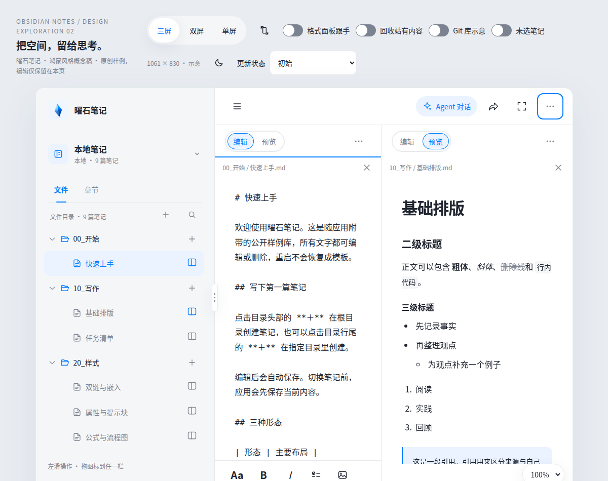
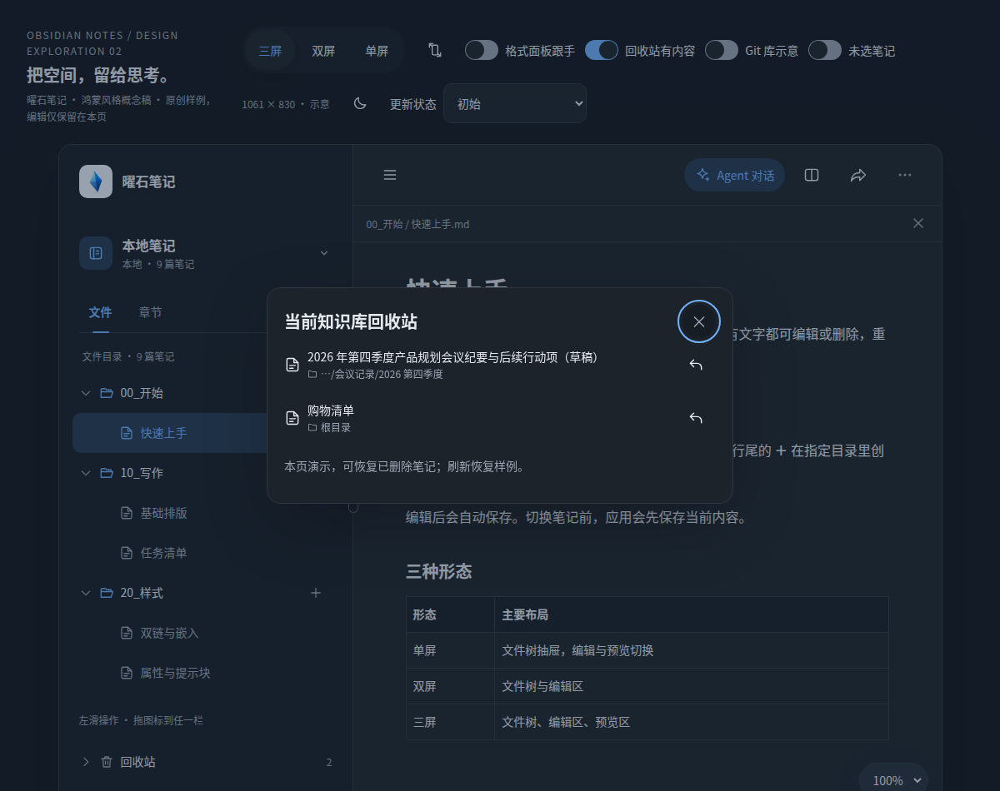
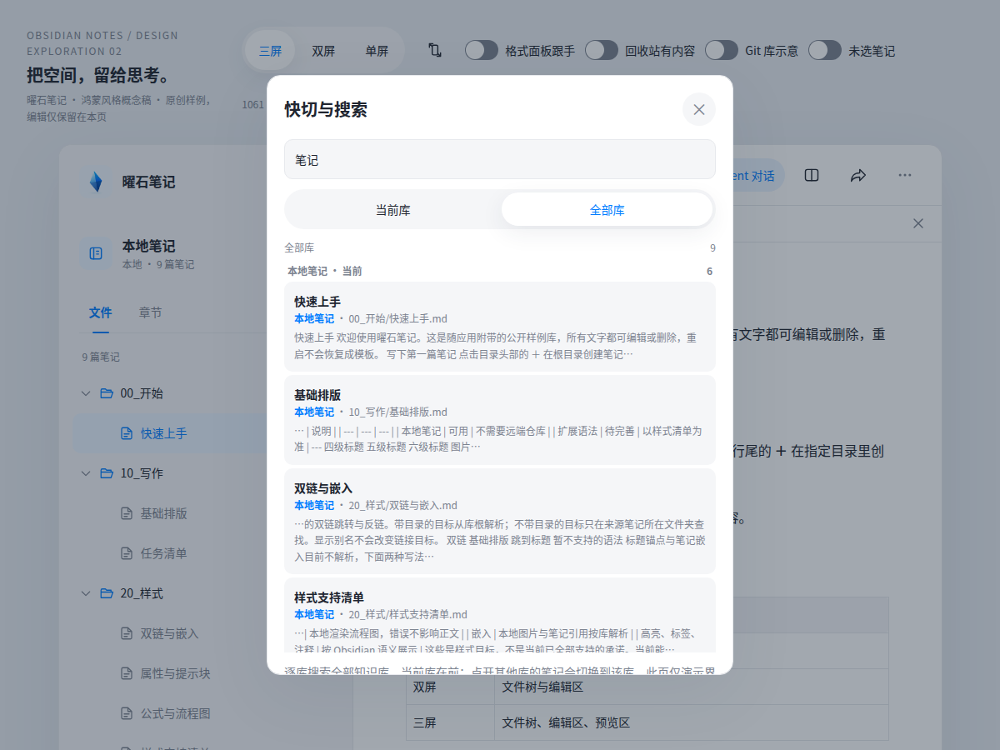
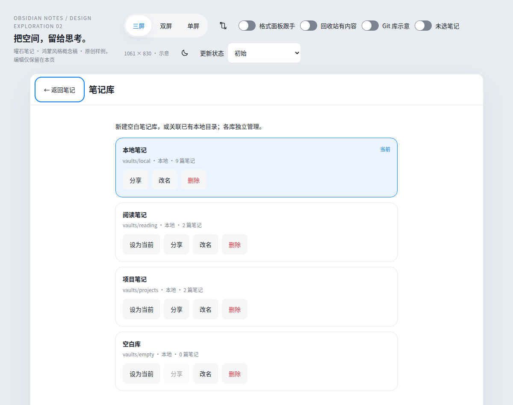
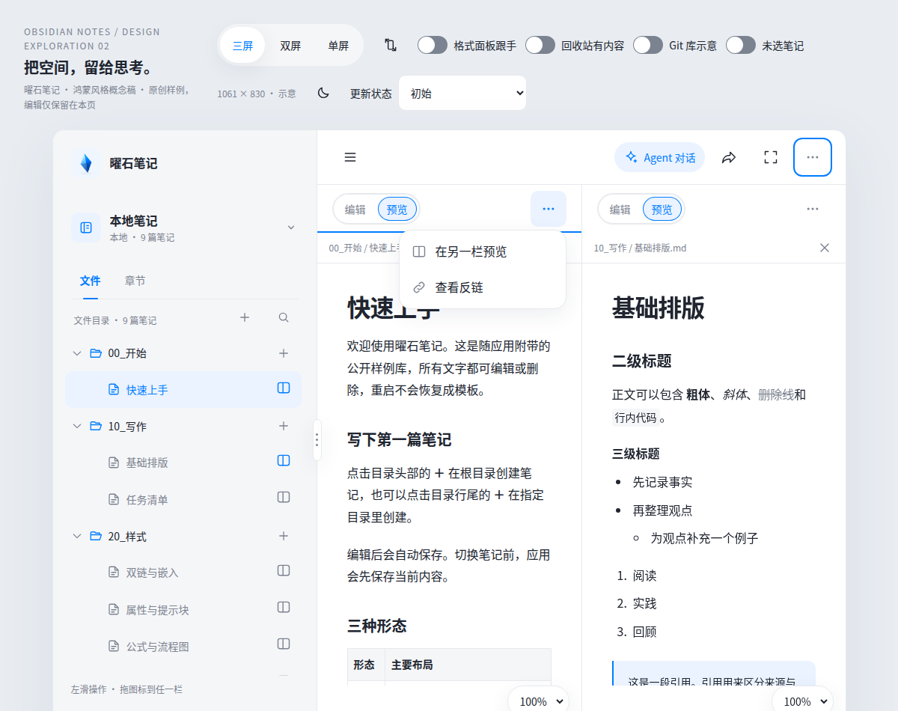
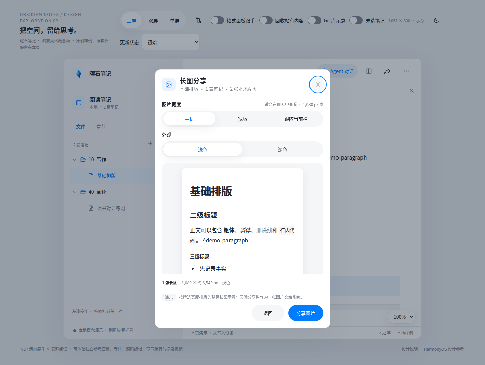
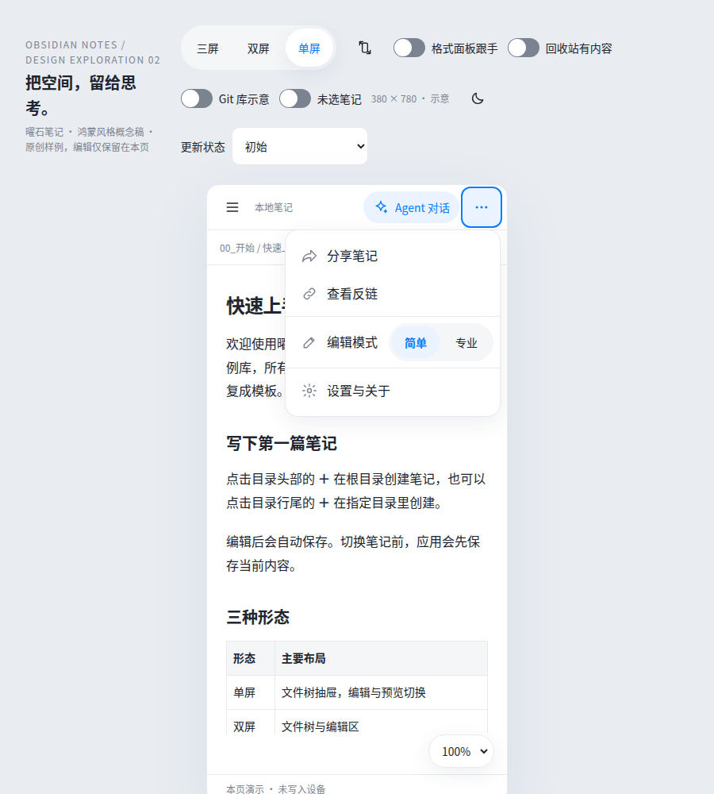
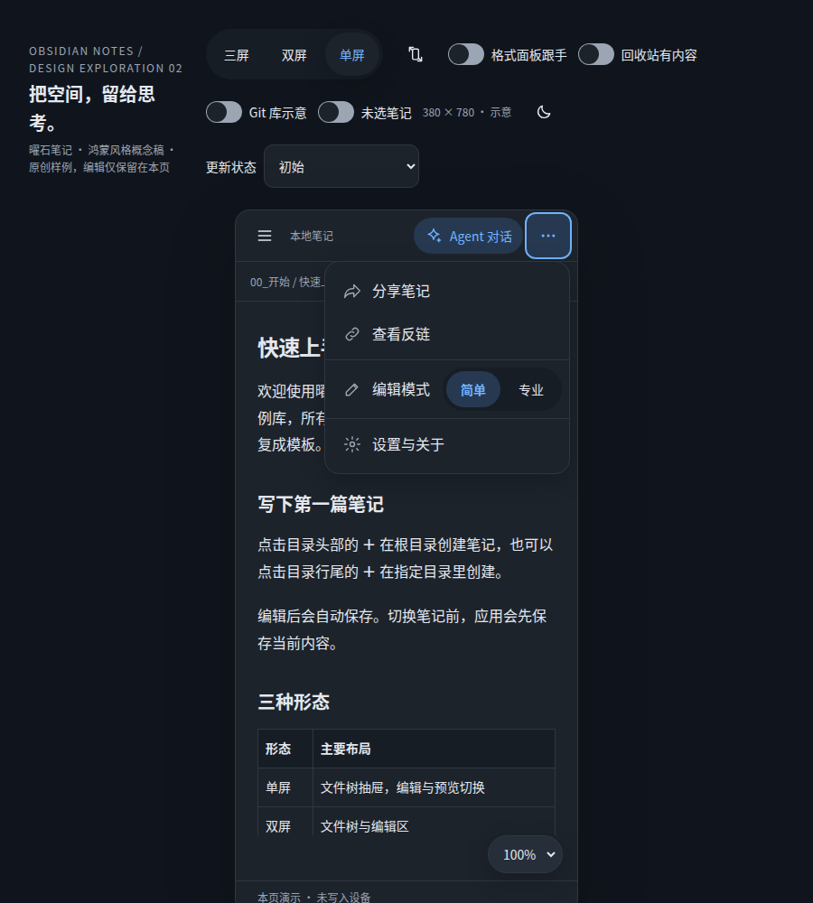
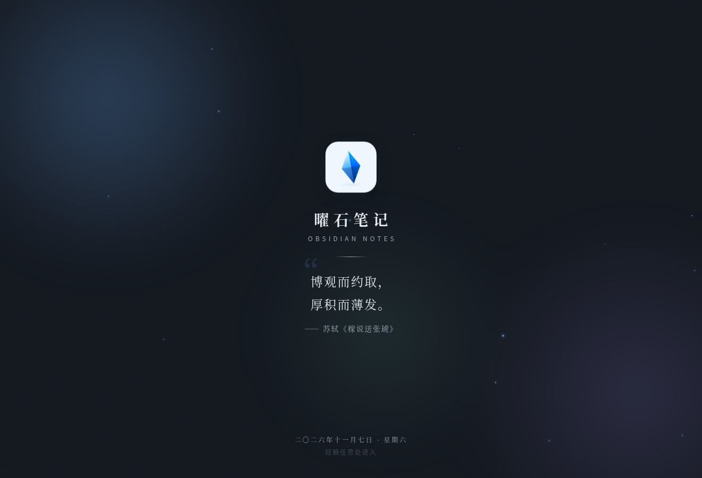

<div align="center">


# 曜石笔记

**为华为 Mate XT2 三折叠打造的本地优先 Markdown 笔记应用**

[](https://developer.huawei.com/consumer/cn/)
[](https://developer.huawei.com/consumer/cn/arkts/)
[](native/git2_napi)
[](LICENSE)

[特性](#特性) · [截图预览](#截图预览) · [下载与安装](#下载与安装) · [从源码构建](#从源码构建) · [文档](#文档)

</div>

---

## 特性

- **为三折叠而生** —— 单屏、双屏、三屏三栏自绘布局，同一份笔记自适应 XT2 每一种展开形态
- **本地优先** —— 笔记就是沙箱里的 Markdown 纯文本，不联网也能完整读写
- **多知识库** —— 沙箱库与外部授权目录库统一管理，一个 App 装下所有 vault
- **Git 同步** —— Native libgit2 直连 GitHub / Gitee，访问令牌只存系统 AssetStoreKit
- **双模式编辑器** —— 简单模式直接书写正文，专业模式保留源码与实时预览
- **丰富的笔记能力** —— 全库搜索、表格、粘贴转表格、长图分享、回收站、深色模式、名言启动页

## 截图预览

> 以下均为设计原型截图（设计真源：[`docs/prototype/v2/index.html`](docs/prototype/v2/index.html)），完整截图存档见 [
`docs/prototype/v2/截图/`](docs/prototype/v2/截图/)。

**三屏展开**

|                                       专业编辑 · 格式栏停靠                                        |                                        深色 · 回收站                                        |                                             全库搜索                                             |
|:-----------------------------------------------------------------------------------------:|:--------------------------------------------------------------------------------------:|:--------------------------------------------------------------------------------------------:|
|  |  |  |

|                                      库管理 · 分享                                       |                                         栏内更多菜单                                         |                                             长图分享                                             |
|:-----------------------------------------------------------------------------------:|:--------------------------------------------------------------------------------------:|:--------------------------------------------------------------------------------------------:|
|  |  |  |

**单屏与启动页**

|                                      单屏 · 更多菜单                                      |                                        单屏 · 深色                                        |                                  启动页 · 名言（浅色）                                   |                                  启动页 · 名言（深色）                                   |
|:-----------------------------------------------------------------------------------:|:-------------------------------------------------------------------------------------:|:-------------------------------------------------------------------------------:|:-------------------------------------------------------------------------------:|
|  |  |  |  |

## 下载与安装

应用尚未上架华为应用市场（版本状态以 [CHANGELOG.md](CHANGELOG.md) 为准，当前均未正式发布）。在发布之前，请从源码自行构建并安装到真机：

1. 在 DevEco Studio 中完成自动签名（详见 [`AGENTS.md`](AGENTS.md) 硬约束 19）；
2. 运行 `.\tools\build.ps1` 构建 HAP；
3. 运行 `.\tools\install.ps1 -Run` 安装到真机并拉起。

## 从源码构建

```powershell
.\tools\build.ps1          # 构建 HAP，不用开 DevEco Studio
.\tools\install.ps1 -Run   # 装到真机并拉起
```

首次构建前必须先编译 Native libgit2（`.build/` 不入库）：

```bash
./native/git2_napi/build.sh                    # arm64-v8a（真机）
OHOS_ARCH=x86_64 ./native/git2_napi/build.sh   # x86_64（本机模拟器）
```

Windows 本机跑模拟器需额外处理 ABI 覆盖（`.\tools\abi.ps1 -Dual`），完整说明见 [`AGENTS.md`](AGENTS.md)。

## 文档

| 文档                                                             | 内容                            |
|----------------------------------------------------------------|-------------------------------|
| [`AGENTS.md`](AGENTS.md)                                       | 开发手册（开工前必读：硬约束、已定决策、已知坑）      |
| [`docs/releases/实施总清单.md`](docs/releases/实施总清单.md)             | 当前实现进度、阻塞项和执行顺序               |
| [`docs/releases/README.md`](docs/releases/README.md)           | 版本规则与需求索引                     |
| [`docs/mvp_design.md`](docs/mvp_design.md)                     | MVP 设计主文档（范围 / 架构 / 里程碑 / 验收） |
| [`docs/requirements_backlog.md`](docs/requirements_backlog.md) | 需求池                           |
| [`docs/open_questions.md`](docs/open_questions.md)             | 待决清单与 TODO 挂起项                |
| [`docs/harmonyos/README.md`](docs/harmonyos/README.md)         | 鸿蒙知识库：与官方 Agent 的问答与结论（单一真源）  |
| [`docs/prototype/v2/index.html`](docs/prototype/v2/index.html) | 当前单文件交互原型（浏览器直接打开）            |

## 开发相关

- **共享样例库**：[sample_vault](sample_vault/README.md) 是原型、首次安装与渲染回归的共用内容源。修改 Markdown 后运行
  `python3 tools/generators/build_sample_vault.py`，用 `--check`
  检查产物一致性。当前优先任务、实现进度与验收缺口统一见[实施总清单](docs/releases/实施总清单.md)。
- **Agent 工程**：Agent 的
  loop、上下文、Tools/Skills、提示词与运行恢复使用[独立需求清单](docs/agent/requirements_backlog.md)
  和[版本线](docs/agent/README.md)。本地 Agent View 不属于当前 App 范围；小艺接入已由用户确认完成，Agent 工程版本与 App
  版本分别管理。
- **版本记录**：[changelog.json](changelog.json) 为内容真源，运行 `python3 tools/generators/build_changelog.py`
  生成 [完整记录](CHANGELOG.md)、App
  版本记录数据和原型数据。维护方式见[数据驱动页面技术储备](docs/engineering/数据驱动页面.md)。

## 许可证

[MIT](LICENSE) © 2026 Jiexin Guo
