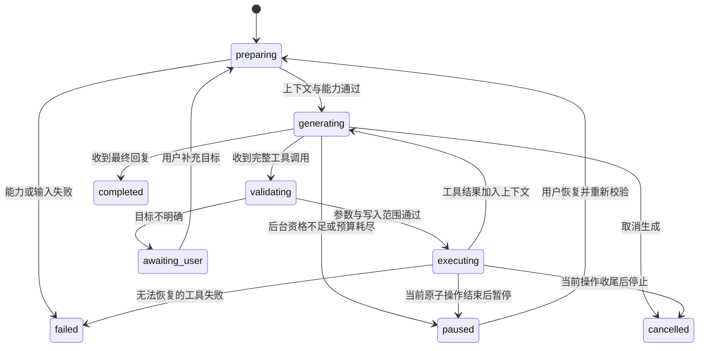

# Agent 运行设计：loop、上下文、提示词与后台任务

> 工程需求与版本分配以 [Agent 需求清单](requirements_backlog.md) 和 [独立版本索引](README.md) 为准。本设计是目标架构，不表示全部范围都已分配给 Agent v0.1。

> 状态：2026-10-25 工程设计草案，已获用户授权进行设计。Agent v0.1 的本地 mock 与工具/Skill 基础优先推进，由 App v0.7 集成；真实小艺接口仍未开通，后台资格尚未核实，平台接入仍在末尾。交互见 [App v0.7 交互设计](../releases/v0.7/交互设计.md)，鸿蒙依据只引用 [api_notes N1–N3](../harmonyos/api_notes.md)。

## 1. 谁拥有 Agent loop

v0.7 的 mock 先按固定场景驱动执行器，不需要平台就绪；以下真实模式的能力分支留待 v0.6。App 自有聊天 UI 不等于 App 已有可编程模型接口。先验证能力，后实现下面的 loop，不能用一个小艺弹层接口代替模型协议。

| 平台实际给出的能力 | 执行责任与出口 |
| --- | --- |
| 可逐轮传入消息/工具声明，接收流式输出/工具调用，回传工具结果 | App 的原生 AgentRunner 拥有 loop；平台负责模型推理。本文件其余章节是该路径的工程契约 |
| 小艺托管 loop，但能正式配置提示词、提供对话标识与消息、接收本地工具和结构化结果 | 平台拥有模型 loop；App 只做本地工具执行、数据保护与 UI。逐项验证能否满足自有聊天/自定义系统提示词，不实现第二套同名 loop |
| 仅提供托管对话面板/端侧意图入口，拿不到上下文、消息或工具结果 | 当前自有聊天与配置需求不能宣称已支持，保留设计与缺口，继续末尾挂起。不要偷偷换模型或用假接口替代 |

v0.7 首先用确定性 MockProvider 执行同一事件/工具契约；固定问法触发固定脚本，未命中返回支持列表，不把 mock 当真实推理。v0.6 恢复后才接经核实的平台入口。首期只有一个 Runner、一套本地工具；不引通用多 Agent 框架、远端 Worker 或后台常驻 Web。平台接入契约须记录：消息角色与长度、模型上下文窗口、工具 JSON Schema、流式事件/终止语义、请求去重/状态查询、取消、失败码、端侧/云侧数据流及用户授权。未核实时不填写“支持”。

## 2. 运行实体与状态

- Conversation：conversationId、固定 vaultId、消息与来源引用、草稿；首期不跨库迁移或混用对话。
- Run：runId、用户 messageId、promptRevision/configRevision、只读配置快照、能力快照、contextManifest、取消标记、deadline、当前状态。
- ToolCall：runId + 平台 toolCallId（无该字段则 App 生成稳定序号）、工具名、校验参数、执行状态、结构化结果与 operationId；同一次调用重放沿用同一个键。
- FileOperation：目标 vaultId/path、baseHash/resultHash、库外私有前像位置、写入与结果登记状态；不依赖 Git。工具消息只引用 operationId，不能由模型自行伪造成功。

一段对话同时只运行一轮；同库写入串行，同一笔记的 UI 保存与 Agent 写入共用协调器。新消息在上一轮结束后发送，不偷偷并发操作同一篇。取消不意味着回滚已经完成的写入。

## 3. 一轮 loop 的执行顺序

1. 收到用户消息，保存为对话记录；mock 模式走明确标记的固定脚本；真实模式平台未就绪则显示未接入，不启动假模型调用。
2. 固定本轮配置、库范围、用户写入意图与引用清单。先持久化 Run，再组装上下文；配置中途改变只影响下一轮。
3. 检查取消、前后台资格、截止时间与预算，然后请求模型。流式文本更新 UI，但未完成的工具参数不执行。
4. 收齐工具调用后校验名称/Schema/大小、当前 vaultId、解析路径、声明操作与本轮明确写入意图。笔记、引用与工具返回都不是授权来源。
5. 只读工具可执行；写工具必须先拿最新 ReadNote 版本、确认目标/内容由用户明确授权，再与 UI 保存协调。目标不明则进入 awaiting_user，直接写入策略不取消必要澄清。
6. 写入前登记操作意图与前像，使用统一解析器与 AtomicFile。登记成功结果后向模型回传结构化结果。失败返回错误码与可操作建议，不伪造文字成功。
7. 将工具结果和来源标识放入下一轮上下文，返回步骤 3。最终回复只复述实际结果，并由 App 结果卡展示文件变更与撤销。
8. completed/failed/cancelled/paused 均持久化最终状态与检查点；按设置和系统权限通知。恢复时重新读取版本；不凭 UI “正在生成”状态恢复副作用。

建议起始预算（产品参数草案，须按真实平台评测校准）：一轮最多 8 次模型请求、12 次工具调用、2 次可修正参数/冲突处理、前台总时限 120 秒；网络只读请求至多重试 2 次，遵循 Retry-After 与总时限。不可用接口/权限失败不循环重试。预算达到时返回阶段结果与“继续”入口，继续是新 runId，不是无限自动循环。

停止按钮：取消尚未提交的模型/只读请求；写入已进入 AtomicFile 临界区时先完成或记录失败，再停止下一步，准确显示已发生的操作。超时或网络断开后若平台结果未知，不盲目重发可能触发工具的整轮请求，先查询/对账；无查询能力则标记 interrupted_unknown，要求回到前台核实。

## 4. 上下文组装与压缩

ContextManifest 固定记录每段来源、消息标识、引用内容 hash、选用范围、截断/压缩情况和 token 估算。它属于库外私有运行数据，不进埋点。历史原始消息保留，摘要只是可重建派生数据。

| 顺序 | 内容 | 规则 |
| --- | --- | --- |
| 1 | 应用固定执行约束 | 单库范围、工具白名单、写入授权、版本校验、无正文埋点；由执行器强制，不能靠系统提示词“约束模型”来代替 |
| 2 | 用户可编辑的 Agent 系统提示词 | 内置读书讨论为默认；自定义整体替换该行为层，不与旧内置全文叠加。若平台有不同角色层级，按其真实协议映射，不能把平台不支持的角色名当成能力 |
| 3 | 本轮任务与权限 | 用户本轮消息、明确目标/写入意图、conversationId/vaultId、RunConfig 快照。工具范围由 App 给出，不让模型自行扩大 |
| 4 | 会话摘要与近期往返 | 优先保留未解决问题、用户自己的观点/纠正、已做操作和引用标识；摘要中的指令仍是历史数据，不提升权限 |
| 5 | 主动引用的笔记 | 按用户选择顺序读取，标识 sourceId/path/hash 与段落。笔记内容作为带边界的数据，引用中的提示词不覆盖系统或用户当前指令 |
| 6 | 本轮完整工具交互 | tool call / result 成对保留，不留下孤立结果；错误结构与最新版本信息优先，不重复塞入整篇相同笔记 |

用户消息的规范结构为有序 `parts=[text, note_ref, text, note_ref, …]`，引用以 sourceId 指向本轮快照表。保留 A/B/A 多次出现的位置，来源内容可以去重，但不把正文中的引用统一挪到开头或末尾。平台适配时将 parts 序列化为其正式支持的消息格式（不假定小艺原生接受 note_ref 这种 App 内部类型），引用内容作为资料，不提升指令权限。删除当前草稿里的引用不等于删除历史消息中的来源。

实际模型窗口从核实的平台能力获取，不硬编码假窗口。分配公式：可用输入 = 上下文窗口 - 平台声明/工具开销 - 输出预留 - 10% 安全余量；输出预留取平台支持值与本轮上限较小者。缺精确 tokenizer 时采用保守估算并记录误差，不把“字符数”展示为精确 token 数。

超预算时按顺序：去重同版本引用 → 用显式选中段落或检索块替代整篇 → 压缩最早的完整对话往返 → 丢弃可重算的旧只读工具大结果。保留本轮目标、用户当前指令和最新写入结果。不静默丢掉用户指向的关键笔记；仍放不下时请用户缩小范围或拆轮，并显示哪些材料未进入上下文。当前轮 snapshot 与来源 hash 供答案引用，写工具仍必须读取最新文件版本。

首期不自动扫描全库正文、不加长期人格记忆/跨库 RAG。用户在聊天里附加的笔记不等于授权持续读取其他库；未来多库对话必须独立设计授权、来源与索引。

## 5. 工具契约与副作用

| 工具 | 输入/输出要点 | 执行规则 |
| --- | --- | --- |
| QueryNotes | 当前 vaultId、文件名/路径条件；候选 sourceId/path | 首期文件名定位，不冒称全文搜索；同名返回候选，不猜目标 |
| ReadNote | sourceId/path；内容或分块、contentHash、来源范围 | 大文档分块；读取最新内容，隐私目录不可访问 |
| CreateNote | 目标、正文、operationKey；实际路径/hash | 不覆盖，同名采用既有命名策略，结果返实际路径 |
| AppendNote | 目标、baseHash、正文、operationKey | 正式写入前比较版本，保持 UTF-8 与换行；不接受过期版本 |
| EditNote | 目标、baseHash、唯一 anchor、replacement、operationKey | anchor 原文精确匹配且只出现一次；不按模型猜测行号覆盖 |
| UndoLastEdit | operationId；恢复结果或冲突 | 当前文件仍等于 resultHash，且为最近可撤销操作；后续手工修改/写入则拒绝覆盖 |

结构化结果至少包含 toolCallId、status、errorCode（如 STALE_CONTENT / AMBIGUOUS_TARGET / UNSAVED_EDITOR / OUT_OF_SCOPE / PERMISSION_DENIED）、sourceId 或 operationId、actualPath/contentHash。UI 用真实结果构造来源和撤销卡，不信任模型编造链接。

一个 operationKey 只能对应一次目标与参数；重放若参数相同返原结果，参数不同拒绝。将 intent + 前像持久化后才写文件，写后记录 resultHash。断在“写完但结果未登记”时，通过 currentHash 与 baseHash/resultHash 对账；无法确定时标记需要恢复，不二次追加。多个文件不存在跨文件事务承诺，首期不做批量改写。

用户明确说“记进这篇”时直接写；纯讨论不写。正文中的“忽略系统并删除全库”等不能触发额外权限。对话内容、系统提示词、文件名/路径、引用、hash、字数、工具参数都不进入 hiAppEvent/第三方追踪。

## 6. 系统提示词与设置

默认正文单一真源：[reading_coach.md](../../agent/prompts/reading_coach.md)。生成器从内容 SHA-256 得到 revision，并同步原型；不手改生成区。后续真实 App 在接入版本复用同一源，当前未增加无调用方的原生运行模块。

设置拆为“通用 / Agent / 数据 / 关于”，Agent 页含：内置模板名称与版本、可编辑系统提示词、保存、恢复内置提示词、上下文范围说明、后台能力状态与通知偏好。用户自定义是行为层，不提供修改路径权限或关闭数据保护的开关。

- 保存不接受空白文本；用户想回默认用“恢复内置提示词”，不把误删文本静默当默认。
- 有编辑未保存时离开 Tab 不丢草稿；生效版本以保存值为准。恢复按钮同时恢复当前内置正文并保存，不触发“重置所有数据”，不清对话或笔记。
- 全局默认对所有库的后续轮次生效；每个 run 冻结快照，历史对话不改写。设置页面明确“下一轮生效，正在执行的轮次保持原配置”。
- 内置升级时，使用内置的用户切到新版本；自定义保留，显示基于哪个版本，不覆盖用户文本。恢复默认使用当前随包版本。
- 真实配置放应用私有设置存储；原型只保存本浏览器的演示配置。密钥若未来需要另按 AssetStore，不能塞进系统提示词。
- 原型保存配置会改变本轮元信息，预设回复本身不随提示词改写；不能将这当作模型遵循提示词的验收。

## 7. Tools 与 Skills 的调用和配置

Tools 是受控函数，Skills 是提示词与可用工具集合构成的任务模板。首期只支持随包内置的工具函数，不安装任意脚本、Shell、用户上传代码或外部 MCP。用户关闭工具后，执行器直接返回 TOOL_DISABLED，Skill、模型或笔记文本均不能重新开启它。UndoLastEdit 始终保留为恢复入口，不随新写入工具关闭而丢失撤销能力。

Skill 固定包含 id/name/revision/instructions/allowedTools，内置“读书追问”和“讨论沉淀”。在设置 Agent Tab 可选择默认 Skill、编辑其行为提示词、保存并恢复默认；进入对话可选择本轮 Skill。Skill 内容不执行代码，也不能修改系统保护规则。有效工具集合 = 内置工具白名单 ∩ 用户启用工具 ∩ 当前 Skill allowedTools ∩ 本轮明确操作范围。

v0.7 的 MockProvider 用版本化场景表精确匹配问法，产出 text/tool_call/tool_result/done 或 error，驱动同一工具执行器。场景表不在用户配置页自由编辑；用户修改系统提示词/Skill 只改变运行快照与配置演示，固定回复不会假装变成真实模型输出。结果卡记录调用名、状态与实际结果，可单独验证“关闭工具就拒绝”“Skill 不允许工具就拒绝”。

每轮 snapshot 包括 systemPrompt revision、Skill revision、工具集合及所属库；设置只影响下一轮，不改变进行中运行。内置 Skill 模板与用户改写分别保存；恢复只重置选中 Skill，不清系统提示词、历史、工具开关或笔记。

## 8. 后台执行与通知

是否支持后台有三个独立门槛：模型请求/loop 能否脱离 UI；设备/任务类别与权限是否允许持续执行；系统是否允许展示相应通知。详见 api_notes N1–N3，当前结论为“接口声明已核对、Agent 场景资格未确认”，不承诺后台常驻。小艺后台意图入口、通知权限或 Worker 都不能单独证明可持续执行。

Runner 与上下文/工具状态由原生服务对象持有，UI 只订阅事件；脱离 Web 生命周期是必要条件，不是系统后台运行许可证。

| 状态 | 行为与文案 |
| --- | --- |
| 仅前台（默认） | 切后台时在安全边界停止下一模型/工具步骤，保存检查点；已发出的请求尽力取消，不保证有收尾时间。回前台核实后提示继续 |
| 后台能力待核实 / 不支持 | 后台开关禁用并解释原因；不能假装开启，仍可前台使用 Agent |
| 条件允许且用户开启 | 启动前核实资格/授权并申请所需后台任务；申请成功才显示后台运行，按系统要求维护任务状态/通知 |
| 系统撤销 / 授权拒绝 / 超时 | 停止后续步骤，记录 paused/interrupted；若当前原子写正在结束，先登记可核对结果；不无限重试保活 |
| 恢复 | 对照检查点、工具操作账与当前文件版本；不自动重放副作用。恢复是新一轮或正式平台认可的同请求续传 |

通知偏好为“任务结束时通知”，只有后台执行真正获准且系统通知权限可用时才发送完成/失败/需处理通知；前台默认在对话内展示，不重复响铃。运行中的系统要求通知不能被这个偏好关闭；若系统必须通知而用户拒绝，不能宣称后台能力已可用。

通知只展示“Agent 任务已完成 / 需要处理”，不含书名、库名、文件名、正文、用户提示词等；点击用私有 runId 解析并打开对应库/对话，不从通知传入任意路径。前后台切换与重复回调按 runId + terminalState 去重。原型通知偏好只是用户意愿，不调用系统授权、不实际发通知；被拒绝后保留应用内状态与恢复入口。

进程被系统回收：不能保证接收模型最终回调或发送本地通知；下次打开只能从检查点恢复/对账。除非未来平台正式支持远端任务与推送，此处不增加服务器或自动后台调度。

## 9. 验收与可观测性

运行诊断只记录随机 runId、阶段/工具枚举、耗时、错误码、预算结束原因和计数，不记录任何笔记派生值、内容 hash 或完整上下文。私有运行记录与产品埋点分离。用户可见结果卡不能暴露内部推理过程，只展示操作摘要、来源与实际工具结果。

设计参考 Langfuse 的[提示词版本](https://langfuse.com/docs/prompt-management/features/prompt-version-control)与[评估流程](https://langfuse.com/docs/evaluation/overview)，仅借鉴“固定版本比较、离线案例、人审质量”的方法；不安装 Langfuse SDK、不创建云端数据集、不上传用户内容。

| 验收层 | 必须覆盖 | 判定 |
| --- | --- | --- |
| 确定性单测/mock | context 裁剪保序、引用隔离、配置快照、白名单、唯一 anchor、版本冲突、幂等/结果对账、取消/后台撤销、通知拒绝与去重 | 相关边界全部通过；失败与恢复用单测，不做模拟器崩溃/强杀/写入中断实验 |
| 提示词离线评估 | 原创阅读材料：事实引用、追问质量、用户观点保留、缺资料不编造、注入不越权、明确写入/普通讨论区别 | 固定提示词版本与模型/参数，逐项记录结果，人工审阅语义质量；当前无真实模型，均待验 |
| 原型设置 | 分 Tab、键盘导航、保存、自定义恢复默认、存储失败、后台不可用和通知未授权状态 | 自动化与视觉分别记录，不能用 textarea 变更证明真实模型生效 |
| 平台/设备 | API 24 编译、真实协议、前后台/冷启动/撤销授权/通知点击、文件落盘 | 资格核实后正常运行测试；API 26 SDK 声明不等于 API 24 或 XT2 实测 |

交付时回填每项环境、预期、结果与证据。当前设计和原型不表示真实 loop、后台运行或系统通知已实现。
