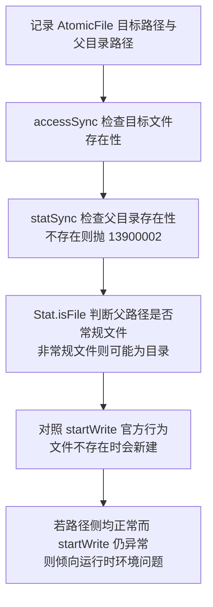

以下是对该份 AtomicFile 答复的逐项核查结果，每项均标注依据类型，无法确认之处已明确说明。

---

### 1. AtomicFile 与 startWrite() 的官方最低 API 版本

**【官方文档明确说明】** `fileIo.AtomicFile` 类与 `startWrite()` 的官方最低版本均为 **API 15**：

- 文档标题：《@ohos.file.fs (文件管理)》，所属 Core File Kit（文件基础服务），导入方式为 `import { fileIo } from '@kit.CoreFileKit'`
- AtomicFile 章节标注为 **AtomicFile15+**，链接：https://developer.huawei.com/consumer/cn/doc/harmonyos-references/js-apis-file-fs#atomicfile15
- startWrite 章节标注为 **startWrite15+**，链接：https://developer.huawei.com/consumer/cn/doc/harmonyos-references/js-apis-file-fs#startwrite15
- 该模块整体说明为"本模块首批接口从API version 9开始支持。后续版本的新增接口，采用上角标单独标记接口的起始版本"

**与 API 26 SDK `@since 15` 声明的关系**：两者一致，不冲突。官方在线文档的上角标（15+）与本机 API 26 SDK d.ts 中的 `@since 15` 是同一信息的两种载体。

**关于 API 24 SDK 的声明**：**无法确认**。我无法访问您本机 API 24 SDK 的 d.ts 文件内容。但依据官方文档，最低版本为 API 15，而您的工程 compatibleSdkVersion 为 API 24（24 ≥ 15），该接口在 API 24 工程中属于可用范围。

---

### 2. startWrite() 是否会返回 13900020

**【官方文档明确说明】** 官方在线文档中 startWrite() 章节的错误码部分仅写明"接口抛出错误码的详细介绍请参见基础文件IO错误码"，**未在该章节列出任何具体错误码清单**。也就是说，官方在线文档的记载粒度与您本机 d.ts 中列出 13900001、13900002、13900012、13900027、13900042 清单的方式不同。

**【本机 SDK 声明】** 您提供的 API 26 SDK d.ts 异常列表不含 13900020——此为您的本机信息，我无法直接核验该文件，但其与官方文档"未列清单"的记载方式不矛盾。

**【官方文档明确说明】** 13900020 在《文件管理错误码》中的通用定义为：错误信息 Invalid argument，错误描述"无效参数"，可能原因"输入参数非法"，处理步骤"确认参数合法性"，链接：https://developer.huawei.com/consumer/cn/doc/harmonyos-references/errorcode-filemanagement#section13900020-无效的参数 

**【文档未记载】** 官方资料**未记载** startWrite() 会返回 13900020，也未记载其触发条件。因此：

- 不能将 13900020 的通用含义（无效参数）直接等同于 startWrite() 的具体失败原因；
- 在官方层面**无法确认** API 26 模拟器上该现象的成因，包括是否与模拟器环境相关；
- 您本机 d.ts 异常列表不含 13900020 这一事实，与"官方未记载 startWrite() 返回 13900020"的结论相互印证。

---

### 3. 父目录、路径、并发等要求逐项核查

| 核查项 | 结论 | 依据类型 |
|---|---|---|
| 父目录必须预先存在且可写 | AtomicFile 章节**未记载**此要求 | 文档未记载 |
| 目标文件不存在时的行为 | **明确说明**："当文件不存在时新建文件"，即不要求目标文件预先存在 | 官方文档明确说明 |
| 写入机制 | **明确说明**：通过写入临时文件，成功后重命名到原始文件位置；失败时删除临时文件，不修改原始文件内容 | 官方文档明确说明 |
| 路径规范化 | **未记载** | 文档未记载 |
| 嵌套目录要求 | **未记载** | 文档未记载 |
| 文件名长度限制 | **未记载**（AtomicFile 章节无此约束） | 文档未记载 |
| 并发/线程安全要求 | **未记载** | 文档未记载 |

需要补充的一点间接依据：**【官方文档明确说明】** 13900002 错误码文档列出可能原因之一为"创建文件时，路径中目标文件所在的目录不存在"，处理步骤含"创建文件时，检查文件父级目录是否存在"。但这是文件管理模块的通用错误码说明，**并非 AtomicFile 专属契约**，不能据此断言 AtomicFile 的父目录行为。

---

### 4. statSync() 的文件不存在错误码与 createWriteStreamSync

**statSync() 文件不存在错误码** —— **【官方文档明确说明】** 为 **13900002（No such file or directory，"没有这个文件或目录"）**，出处《文件管理错误码》：https://developer.huawei.com/consumer/cn/doc/harmonyos-references/errorcode-filemanagement#section13900002-没有这个文件或目录 

statSync 签名为 `statSync(file: string | number): Stat`，从 API 9 起支持（元服务从 API 11 起，从 API 22 起支持传入 URI），链接：https://developer.huawei.com/consumer/cn/doc/harmonyos-references/js-apis-file-fs#fileiostatsync 。您本机 SDK 将 13900002 标为文件不存在、未将 13900015 列为文件不存在，与官方文档一致。

**createWriteStreamSync** —— **【官方文档明确说明】** HarmonyOS 公开 API 中**不存在**名为 `createWriteStreamSync` 的接口。对应的公开 API 是 `fileIo.createWriteStream`（API 12+），其本身即为同步方法（"以同步方法打开文件可写流"），签名：

```typescript
createWriteStream(path: string, options?: WriteStreamOptions): WriteStream
```

链接：https://developer.huawei.com/consumer/cn/doc/harmonyos-references/js-apis-file-fs#fileiocreatewritestream12 。您在本机声明中找不到 `createWriteStreamSync` 是正常的，官方命名即为 `createWriteStream`，并非 SDK 缺失。

---

### 5. API 24 可用、不写入/不删除目标文件的官方诊断步骤

**【官方文档明确说明】** 以下接口均为只读诊断性质，不会写入或删除工作区目标文件，且最低版本均不高于 API 24：

| 接口 | 签名 | 最低版本 | 关键错误码 |
|---|---|---|---|
| fileIo.accessSync | `accessSync(path: string, mode?: AccessModeType): boolean` | API 9（元服务 API 11） | 13900012（权限校验不通过） |
| fileIo.accessSync（重载） | `accessSync(path: string, mode: AccessModeType, flag: AccessFlagType): boolean` | API 12 | 13900012 |
| fileIo.statSync | `statSync(file: string \| number): Stat` | API 9（元服务 API 11） | 13900002（文件或目录不存在） |

依据说明：

- accessSync "以同步方法检查文件或目录是否存在，或校验操作权限"，不填 mode 默认校验存在性，返回 true 表示存在、false 表示不存在；校验读、写或读写权限不通过会抛 13900012。API 12 重载可校验文件是否在本地，官方示例使用 `AccessModeType.EXIST` 与 `AccessFlagType.LOCAL`
- statSync 返回包含文件大小、权限模式、访问时间等属性的 Stat 对象；官方文档明确说明"可通过 statSync 获取文件属性后调用 Stat.isFile() 判断文件是否为常规文件"，Stat 类的构建需先通过 stat 方法完成

诊断流程如下：



参考诊断代码：

```typescript
import { fileIo } from '@kit.CoreFileKit';
import { BusinessError } from '@kit.BasicServicesKit';

function diagnosePath(targetPath: string, parentDir: string): void {
  // 步骤1：检查目标文件是否存在，仅读取，不写入不删除
  try {
    let fileExists: boolean = fileIo.accessSync(targetPath);
    console.info(`目标文件存在: ${fileExists}`);
  } catch (error) {
    let err: BusinessError = error as BusinessError;
    console.error(`accessSync 异常. Code: ${err.code}, message: ${err.message}`);
  }

  // 步骤2：检查父目录是否存在及其类型
  try {
    let dirStat: fileIo.Stat = fileIo.statSync(parentDir);
    // isFile 为 false 且路径存在，说明父路径不是常规文件，符合目录特征
    console.info(`父路径存在, 是否常规文件: ${dirStat.isFile()}`);
  } catch (error) {
    let err: BusinessError = error as BusinessError;
    // 13900002 表示没有这个文件或目录
    console.error(`statSync 异常. Code: ${err.code}, message: ${err.message}`);
  }
}
```

补充说明：

- 上述流程不使用 stream、open、unlink 等方式绕过 AtomicFile，全部为只读探测；
- 关于 4096 字符路径上限、"API 24 与 API 26 错误码体系一致"等说法，官方文档**未记载**，本次核查不予采信；
- 若路径侧诊断全部正常而 startWrite() 在 API 26 模拟器上仍返回 13900020，由于官方未记载该场景，建议通过开发者工单渠道反馈，并附上本答复中列出的官方依据对照信息。

---

### 核查结论汇总

1. AtomicFile 与 startWrite() 官方最低版本为 API 15，与本机 API 26 SDK `@since 15` 一致；API 24 SDK 声明无法确认，但 API 24 ≥ 15，接口可用。
2. 官方文档未记载 startWrite() 返回 13900020 的任何场景；13900020 仅为通用"无效参数"定义，不可直接套用。
3. 除"文件不存在时新建文件"与临时文件写入机制外，父目录预置、路径规范化、文件名长度、并发安全等均未记载。
4. statSync 文件不存在错误码为 13900002；`createWriteStreamSync` 不是公开 API，官方名称为 `createWriteStream`（API 12+，同步方法）。
5. accessSync（API 9/12）与 statSync（API 9）构成 API 24 可用的只读诊断组合，不触碰目标文件内容。
内容由 AI 生成，仅供参考