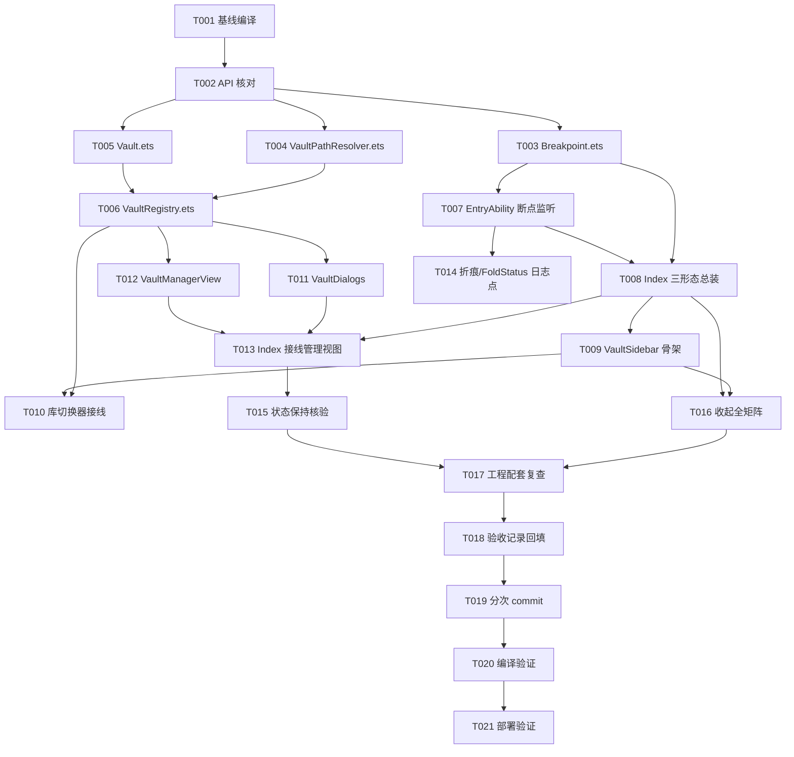

# Tasks: v0.1 三形态骨架与多库（M0 + M0.2）

**Input**: Design documents from `spec/v0.1_skeleton_vault/`（spec.md + plan.md）
**Prerequisites**: plan.md (required), spec.md (required for user stories)
**Verification scope**: build-only（用户已在 Verification Choice Gate 选定「Run verification」）

## Format: `[ID] [P?] [Story] Description`

- **[P]**: 可并行（不同文件、无未完成依赖）
- **[Story]**: 归属的用户故事（US1–US5，映射 spec.md）
- 所有路径相对仓库根 `E:/github/huawei-xt2-obsidian`

---

## Phase 1: Setup（共享基础设施）

**Purpose**: 动手前确认基线与 API 事实（铁律 1：禁凭记忆编 API）

- [x] T001 基线编译验证：运行 `.\tools\build.ps1`，确认改造前工程 BUILD SUCCESSFUL；若失败，记录既有错误并在最终报告注明（不得把既有失败算到本次改动头上）
- [x] T002 API 逐条核对（对照 plan.md「API 使用清单」）：用 `devecocli docs search/read` 与 DevEco 补全知识确认以下 API 在 API 24 的存在性与签名——`preferences.getPreferencesSync/getSync/putSync/flush`、`fileIo.rmdirSync`（**递归删除语义**）/`renameSync`/`mkdirSync`/`accessSync`、`display.getFoldStatus/on('foldStatusChange')/getCurrentFoldCreaseRegion/isFoldable`、`window.on('windowSizeChange')/getMainWindowSync/getWindowProperties().windowRect`、`px2vp`；**任何一条确认不了 → 写入最终报告「需要确认的 API」，禁止猜测落码**

---

## Phase 2: Foundational（阻塞性前置，全部用户故事依赖此阶段）

**Purpose**: 模型层 + 断点机制就位

- [x] T003 [P] 新建 `entry/src/main/ets/model/Breakpoint.ets`：断点常量（`'sm'|'md'|'lg'`）+ 阈值常量（600/840vp，出自 mvp_design §2）+ `breakpointFromWidthVp(widthVp): string` 半开区间判定（sm<600，md∈[600,840)，lg≥840）
- [x] T004 [P] 新建 `entry/src/main/ets/model/VaultPathResolver.ets`：全工程唯一路径解析层——`vaultDir(vaultId)`、`resolve(vaultId, relativePath)`；Context 注入；路径只从 `context.filesDir` 拼出（AGENTS 硬约束 14）；拒绝 `..` 片段与绝对路径入参
- [x] T005 [P] 新建 `entry/src/main/ets/model/Vault.ets`：`VaultEntry` 接口（id/type/createdAt，id=目录名=显示名）+ `sanitizeVaultName(raw): string` 消毒纯函数（过滤 `/ \ : * ? " < > |` 与控制字符 → 去前导点 → trim → 空返回空串）
- [x] T006 新建 `entry/src/main/ets/model/VaultRegistry.ets`（依赖 T004、T005）：注册表单例——`init()`（首启无注册表时自动建 `vaults/local` 并设当前库）/`list()/currentId()/setCurrent(id)/createLocal(name)/rename(id,newName)/remove(id)`；重名自动加 `-2`；改名失败回滚禁半状态；删除后当前库回落列表第一个；preferences 单 key JSON 持久化（杀进程重进还在）
- [x] T007 改造 `entry/src/main/ets/entryability/EntryAbility.ets`（依赖 T003）：`onWindowStageCreate` 中 `getMainWindowSync()` + `window.on('windowSizeChange')` 回调 `px2vp(size.width)` 判档写入 `AppStorage`（key：`breakpoint`、`windowWidthVp`）；loadContent 前用 `getWindowProperties().windowRect.width` **补算初始断点**（事件只在变化时触发）；**不用** `getFoldDisplayMode()` 做分支（api_notes A3）

**Checkpoint**: 模型层可独立单测（逻辑自查），断点事件链路通，用户故事可开工。

---

## Phase 3: User Story 1 - 三档断点与三栏骨架自绘 (Priority: P1) 🎯 MVP

**Goal**: 三形态布局按断点正确切换：sm 单栏+抽屉、md 各 50%、lg 各 1/3；自绘，禁用 FoldSplitContainer。

**Independent Test**: 任意断点值下布局结构符合 plan.md 布局矩阵，无控件溢出；状态栏显示当前档位与 vp 宽度。

- [x] T008 [P] [US1] 重写 `entry/src/main/ets/pages/Index.ets`：三形态布局总装——sm 用 `Stack`（单栏内容 + 抽屉侧栏覆盖层，汉堡开关）；md/lg 用 `Row` 等分（侧栏 50%/33.33%，编辑/预览占位栏各 50%/33.33%）；appbar（汉堡、标题=当前库名、库管理入口）；状态栏（档位 + vp 宽度 + 当前库）；占位栏标注「编辑区 · v0.2」「预览 · v0.2」；**注释写明为什么自绘**（api_notes A2-bis 否决 FoldSplitContainer 三条理由）
- [x] T009 [P] [US1] 新建 `entry/src/main/ets/components/VaultSidebar.ets`：侧栏骨架——头部区、树区占位（「文件树 · v0.2」）、右上角「收起 «」按钮（回调父级）、底部「管理库」按钮；支持嵌入（md/lg Row 子项）与抽屉（sm 覆盖层）两种挂载形态

**Checkpoint**: 三形态骨架可运行，占位内容可见，断点切换布局正确。

---

## Phase 4: User Story 2 - 库模型：注册表持久化 + 库 CRUD (Priority: P1) 🎯 MVP

**Goal**: 首启自动建 `vaults/local`；新建/改名/删除/切库全流程可用；杀进程重进库列表还在。

**Independent Test**: 新建库（含非法字符输入、重名输入）→ 改名 → 切库 → 删除（确认弹窗文案核对）→ 杀进程重进列表恢复。

- [x] T010 [US2] `entry/src/main/ets/components/VaultSidebar.ets` 库切换器接线：侧栏头部库切换器（当前库名 + 下拉菜单列全部库、当前项高亮、点选调 `VaultRegistry.setCurrent` 切库）
- [x] T011 [US2] 新建 `entry/src/main/ets/components/VaultDialogs.ets`：三个 CustomDialog——①新建本地库（TextInput + 消毒结果与目标路径实时预览 + 空名禁用确认）；②改名（同结构，预填现名）；③删除确认（标题「删除本地笔记？」+ **不可逆/无法恢复**明示 + `vaults/<id>` 路径展示；**不出现**「建议先导出备份」文案——zip 导出未实现）
- [x] T012 [US2] 新建 `entry/src/main/ets/components/VaultManagerView.ets`：库管理视图——库卡片列表（当前库高亮；每卡「设为当前 / 改名 / 删除」操作）+「+ 新建本地库」入口；**无** Git 导入入口（v0.3）
- [x] T013 [US2] `entry/src/main/ets/pages/Index.ets` 接线（依赖 T008、T012）：侧栏「管理库」→ `VaultManagerView` 整体替换内容区，管理视图带返回；对话框按操作拉起并接 `VaultRegistry` 对应方法

**Checkpoint**: 库 CRUD 全流程闭环；重进应用注册表恢复。

---

## Phase 5: User Story 3 - 形态切换状态保持 + FoldStatus 真机数据点 (Priority: P2)

**Goal**: 折叠/展开时当前库与选中项不丢；真机可采集 FoldStatus/折痕数据点。

**Independent Test**: 任一库上折叠→展开，当前库名不变；hilog 可见带 `TODO(真机校准)` 标记的打印点。

- [x] T014 [US3] `entry/src/main/ets/entryability/EntryAbility.ets` 日志点（依赖 T007）：断点变化时 hilog 打印 `getCurrentFoldCreaseRegion()` 返回 Rect、`getFoldStatus()` 返回值、窗口 vp 宽；订阅 `display.on('foldStatusChange')` 打印变化；日志 tag 带 `TODO(真机校准)` 语义（**不硬编码**三屏态映射——官方未记载，api_notes A1 ❓）
- [x] T015 [US3] 状态保持核验与调整（依赖 T008、T013）：复查断点变化路径上——当前库（注册表持久）、侧栏收起态、管理视图开关、抽屉开关（`@State` 存活，UIAbility 不重建 api_notes A4 ✅）——均不丢；状态栏随断点联动刷新

**Checkpoint**: 形态切换状态保持逻辑闭合，日志点就位。

---

## Phase 6: User Story 4 - 目录栏整体收起（md / lg） (Priority: P2)

**Goal**: md/lg 目录栏可收起/唤回，双屏收起不跨折痕，三屏收起编辑区扩 2/3 并标红警示。

**Independent Test**: md 收起→「编辑|预览」各 50%；lg 收起→编辑 2/3 且 1/3 处见红色虚线+「被内容横跨」；汉堡唤回按档位恢复。

- [x] T016 [US4] `entry/src/main/ets/pages/Index.ets` 收起全矩阵（依赖 T008、T009）：侧栏「收起 «」触发——md：侧栏隐藏，编辑 50% + 预览 50%（腾出栏给预览，**不跨折痕**）；lg：编辑扩 2/3（**跨第一条折痕**，在编辑区 1/3 处渲染红色虚线折痕标记 + 「被内容横跨」提示，原型明确要求）+ 预览 1/3；顶栏汉堡按钮唤回（sm 态汉堡=抽屉开关）；注释写明「跨折痕是物理限制非 bug」

**Checkpoint**: 原型收起交互全矩阵达成。

---

## Phase 7: User Story 5 - 工程配套：路径解析器与命名规范 (Priority: P3)

**Goal**: 路径解析唯一一层；命名规范统一。

**Independent Test**: 全局检索确认路径拼接只出现在 VaultPathResolver；所有新文件/目录名符合下划线规范。

- [x] T017 [US5] 工程配套复查（依赖 T004–T016）：全局检索确认 `filesDir/vaults` 拼接仅存在于 `VaultPathResolver`（UI/对话框/管理视图不得旁路）；新建文件与目录命名无空格无连字符（中文下划线规范）；每个非显而易见设计决策已留一行理由注释（硬约束相关处必注）

---

## Phase 8: Polish（收尾）

**Purpose**: 文档回填与提交

- [x] T018 更新 `docs/releases/v0.1/需求文档.md`「验收记录」小节：填写离线可自查项（编译结果、逻辑自查结论）；真机项（三档切换/FoldStatus/折痕 Rect）留「待真机验证」占位；**不改** `docs/harmonyos/api_notes.md` 既有结论
- [x] T019 按「一个逻辑改动一个 commit」提交全部变更：中文 commit，格式 `feat(v0.1): <简述>`（如：断点系统、三栏骨架、库模型、收起矩阵、文档回填分次提交）；不得混入无关文件

---

## Phase 9: Verification

<!-- verification_scope: build-only -->

**Purpose**: 编译与可部署性验证（用户选定 build-only，无 UI 验证任务）

- [x] T020 编译验证：运行 `.\tools\build.ps1`（已内置 JAVA_HOME，勿手动设），修复循环直至 **BUILD SUCCESSFUL**；编译失败不许交付
- [x] T021 部署验证：尝试 `devecocli run --skip-build` 部署到已连接设备/模拟器；无可用设备则在报告中记录「无设备，部署未验证」

---

## 📊 Dependency Graph

## ⚡ Parallel Execution Guide

| Phase | Tasks | Required Files | Execution Notes |
| --- | --- | --- | --- |
| Foundational | T003、T004、T005 | model/Breakpoint.ets、model/VaultPathResolver.ets、model/Vault.ets | 三文件互不依赖，可并行写 |
| US1 | T008、T009 | pages/Index.ets、components/VaultSidebar.ets | 结构先定（T008 先开工），组件可并行写后接线 |
| US2 | T011、T012 | components/VaultDialogs.ets、components/VaultManagerView.ets | 两文件独立，可并行写；接线任务 T010/T013 须串行 |
| Verification | T020 → T021 | — | 必须先编译成功再部署 |

## Notes

- 每个任务完成即自查对应验收点；Checkpoint 处停下确认该故事独立可测。
- 提交策略：T019 统一规划，但实现过程中每完成一个逻辑单元（如 T006、T008+T009、T011–T013、T016）即可先 commit，格式 `feat(v0.1): <简述>`。
- 任何 API 在 T002 核对不通过 → 降级实现或列入「需要确认的 API」，**不得猜测签名**。
- 不动 `web/gitbridge/`、`entry/src/main/ets/git/`、`entry/src/main/ets/pages/SyncPage.ets`、`AppScope/`。
