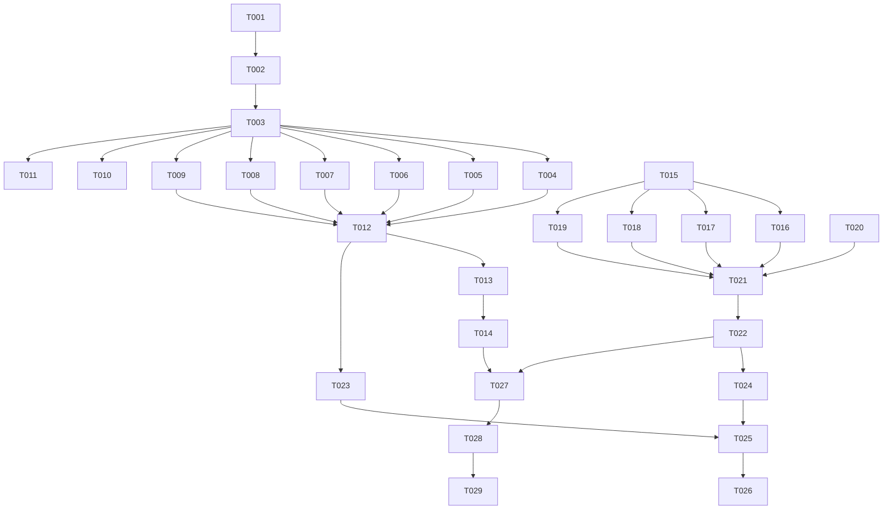

# Tasks: 回归测试补全（Bug 驱动）

**Input**: Design documents from `spec/回归测试补全/`
**Prerequisites**: plan.md (required), spec.md (required for user stories)

**Tests**: 本工作的核心就是补测试，所有任务均以测试交付为产出。

**Organization**: 任务按 User Story 组织，每个 Story 可独立验证。

## Format: `[ID] [P?] [Story] Description`

- **[P]**: 可并行执行（不同文件、无依赖）
- **[Story]**: 归属 User Story（US1/US2/US3/US4）
- 描述含具体文件路径

---

## Phase 1: Setup（共享基建）

**Purpose**: 创建 bug 回归清单框架与盘点工具

- [ ] T001 创建 bug 回归清单框架文档——含 Markdown 表头（来源/摘要/根因类别/版本/防线/状态）、汇总区占位、状态枚举说明 →
  `docs/testing/bug回归清单.md`

---

## Phase 2: Foundational（阻塞性前置）

**Purpose**: 全量盘点历史 bug 并完成防线核对——后续所有补缺工作依赖此清单

**⚠️ CRITICAL**: 未完成盘点前不得开始任何补缺任务

- [ ] T002 提取全部 fix 提交清单——运行 `git log --oneline --grep="^fix" -i` 获取 143 条提交，叠加
  `docs/harmonyos/api_notes.md` ⚠️ 条目中属应用缺陷的部分（纯环境限制如 L-8 排除，仅作参考行），逐条写入
  `docs/testing/bug回归清单.md`（来源、摘要、根因类别、涉及版本字段）
- [ ] T003 逐条防线核对——对清单中每条 bug，在 `tools/tests/*.mjs`、`entry/src/ohosTest/ets/test/ui/*.test.ets`、
  `docs/testing/UI自动化测试.md` 映射表、EM 用例关联列中搜索对应防回归测试，填充「防线」字段（测试文件:用例名 或
  标记缺口），统计各状态计数写入清单汇总区

**Checkpoint**: 清单盘点完成——每条 bug 有防线归属或缺口标记，后续补缺可按清单执行

---

## Phase 3: User Story 1 - Bug 回归清单与防线补全 (Priority: P1) 🎯 MVP

**Goal**: 清单中所有「无防线」缺口获得对应层面的自动化测试

**Independent Test**: 清单汇总区不存在「无防线」状态条目（已补/不可自动化/根因已消除三态之一）

### 3A: 逻辑层缺口 → Node 单测

- [ ] T004 [P] [US1] 为「状态管理」类无防线 bug 补 Node 防回归测试（盘点结果中 V1/V2 混用、@Builder 参数传递等 bug，对应
  `test_*_state*.mjs` 或新建文件）→ `tools/tests/`
- [ ] T005 [P] [US1] 为「ArkUI 布局与弹层」类无防线 bug 补源码断言测试（弹层定宽、constraintSize 误解析等 bug，对应
  `test_*_design.mjs` 或新建）→ `tools/tests/`
- [ ] T006 [P] [US1] 为「文件 IO 与原子性」类无防线 bug 补 Node 防回归测试（AtomicFile end 收尾、mkdirSync 单级等 bug，对应
  `test_*_save*.mjs`/`test_*_atomic*.mjs` 或新建）→ `tools/tests/`
- [ ] T007 [P] [US1] 为「焦点与键盘」类无防线 bug 补 Node/UI 防回归测试（requestFocus 150003 闪退、焦点归还等 bug；逻辑层可
  Node 测的走 Node，需控件树的留待 US3 UI 用例）→ `tools/tests/`
- [ ] T008 [P] [US1] 为「日志与隐私」类无防线 bug 补 Node 防回归测试（日志脱敏、笔记内容泄露等 bug，对应
  `test_*_privacy*.mjs`/`test_*_log*.mjs` 或新建）→ `tools/tests/`
- [ ] T009 [P] [US1] 为「Git 与桥接」「Web 编辑器」「构建链与签名」「其他」类无防线 bug 补 Node 防回归测试（按盘点结果逐类补，git
  credential / @BuilderParam this 丢失 / 签名链等）→ `tools/tests/`

### 3B: 不可自动化条目处置

- [ ] T010 [US1] 为不可自动化条目标注原因与人工依赖——逐条在清单标注「不可自动化」+ 依赖的 EM 人工用例编号或用户真机验收项；如无对应
  EM 用例则在 `docs/testing/模拟器回归用例.md` 补用例

### 3C: 根因已消除条目处置

- [ ] T011 [US1] 为根因已消除条目标注——代码重构后 bug 根因不复存在的，在清单标注「根因已消除」+ 现状测试覆盖确认

### 3D: 防线补全验证

- [ ] T012 [US1] 跑全仓 Node 测试验证新增测试通过——确保零新增失败（5 项既有基线不计），更新清单汇总区各状态计数 →
  `node tools/tests/各新增文件.mjs` + 全仓

**Checkpoint**: 清单中不存在未处置的「无防线」条目；所有新增 Node 测试通过

---

## Phase 4: User Story 2 - 过程 Bug 修复 (Priority: P2)

**Goal**: 补测试过程中发现的实现缺陷直接修复，修复必带防回归测试

**Independent Test**: 每个修复有：修复 diff + 修复前失败的防回归测试

- [ ] T013 [US2] 过程 bug 修复——在 T004–T012 执行中发现任何实现缺陷，按 `fix(<域>): <描述>` 提交修复，修复附带防回归测试（修复前失败、修复后通过），在
  `docs/testing/bug回归清单.md` 末尾「本轮新修复」小节登记
- [ ] T014 [US2] 修复验证——每个修复后跑相关定向回归 + 全仓 Node 验证零新增失败 + `arkts_check` 干净 + 签名 HAP 构建成功

**Checkpoint**: 所有发现的 bug 已修复且带防回归测试

---

## Phase 5: User Story 3 - UI 自动化扩展 (Priority: P2)

**Goal**: 按 EM 用例组扩展 x86 可达子集自动化，降低人工回归负担

**Independent Test**: `docs/testing/UI自动化测试.md` 映射表与实际用例一一对应；`uitest.ps1 -Suite` 可选执行新套件

### 5A: 可测性锚点

- [ ] T015 [US3] 为主工程补 UI 可测性 `.id()` 锚点——新 UI 用例需要的控件缺 id 的，在对应 `.ets` 文件补 kebab-case id（如
  `quick-switcher-scope-toggle`、`trash-restore-button`），不改变布局与行为 → `entry/src/main/ets/`

### 5B: 快切/搜索域 UI 用例

- [ ] T016 [P] [US3] 实现 UiQuickSwitch 套件——EM-E1 快切开合（范围分段「当前库」默认值验证）、EM-E2
  范围分段切换与分组可见性（跨库结果分组）、EM-E3 跳过提示可见性 → `entry/src/ohosTest/ets/test/ui/UiQuickSwitch.test.ets`

### 5C: 回收站域 UI 用例

- [ ] T017 [P] [US3] 实现 UiTrash 套件（或扩展 UiNoteFlow）——EM-B4 回收站区块可见 + 恢复操作（按钮路径，不依赖左滑手势）→
  `entry/src/ohosTest/ets/test/ui/UiTrash.test.ets` 或扩展 `UiNoteFlow.test.ets`

### 5D: 设置扩展域 UI 用例

- [ ] T018 [P] [US3] 实现 UiSettingsExt 套件——EM-F2 诊断信息页可见（含构建提交行）、EM-F5 更新日志列表非空 + 不超前当前版本、EM-F6
  恢复等分栏宽行可见与 brand 色 → `entry/src/ohosTest/ets/test/ui/UiSettingsExt.test.ets`

### 5E: 分享/导入弹窗域 UI 用例

- [ ] T019 [P] [US3] 实现分享/导入弹窗 UI 用例（并入 UiPanels 或新建）——EM-J2 分享面板打开/关闭/范围分段可见、EM-M1
  导入弹窗视觉三态卡片可见 → `entry/src/ohosTest/ets/test/ui/UiPanels.test.ets` 扩展 或新建

### 5F: Git 界面域评估

- [ ] T020 [US3] 评估 Git 界面域 fixture 可行性——EM-K2 同步界面与 EM-K4 本地提交需在模拟器内构造本地 Git 库
  fixture，评估成本后决定：可实现→补用例；成本过高→标注不可自动化+EM 人工依赖，在清单与映射表登记评估结论

### 5G: harness 接线同步

- [ ] T021 [US3] 三处接线同步——① `List.test.ets` 注册新套件 import + testsuite() 调用；② `tools/uitest.ps1`
  `$knownSuites` 数组追加新套件名；③ `docs/testing/UI自动化测试.md` 映射表补新用例行（含 EM 对应编号，无对应 EM 的先补
  `模拟器回归用例.md`） → 三处文件

### 5H: UI 用例构建验证

- [ ] T022 [US3] ohosTest HAP 构建验证——确保 `hvigorw assembleHap --mode module -p module=entry@ohosTest` 构建成功，所有新
  UI 用例编译通过

**Checkpoint**: 新 UI 套件代码就绪、harness 接线完成、ohosTest HAP 构建通过

---

## Phase 6: User Story 4 - 测试基建一致性维护 (Priority: P3)

**Goal**: 所有新增测试资产可一键回归，映射表与实况一致

**Independent Test**: 全仓 Node 一键通过；`uitest.ps1` 可跑新套件；映射表无遗漏

- [ ] T023 [P] [US4] 全仓 Node 测试终验——确认零新增失败（5 项既有基线不计），如有新增失败则归因修复 → `node tools/tests/全仓`
- [ ] T024 [P] [US4] 映射表与用例实况一致性核对——逐行核对 `docs/testing/UI自动化测试.md` 映射表与
  `entry/src/ohosTest/ets/test/ui/*.test.ets` 实际 `it()` 用例一一对应，补漏删废 → `docs/testing/UI自动化测试.md`

**Checkpoint**: 基建一致性确认

---

## Phase 7: Polish（收尾与文档整理）

**Purpose**: 清单最终汇总、文档整理

- [ ] T025 [P] bug 回归清单最终汇总——统计各状态计数（已有防线 / 已补防线 / 不可自动化 / 根因已消除 / 本轮新修复），更新
  `docs/testing/bug回归清单.md` 汇总区
- [ ] T026 [P] spec 工件整理——按用户指示保留或清理 `spec/回归测试补全/` 目录；如保留则确保 spec.md / plan.md / tasks.md
  反映最终状态

---

## Phase 8: Verification

<!-- verification_scope: build+ui -->

**Purpose**: 构建、部署与 UI 终验

- [ ] T027 签名 HAP 构建 + ohosTest HAP 构建——`.\tools\build.ps1` 主 HAP +
  `hvigorw assembleHap --mode module -p module=entry@ohosTest` 测试 HAP，修复编译错误直至成功
- [ ] T028 部署到 x86_64 模拟器——确认 x86_64 ABI 覆盖（`.\tools\abi.ps1 -Status`）、模拟器在线、双 HAP 安装成功；如需启动模拟器由
  `uitest.ps1` 自动处理
- [ ] T029 统一全量 UI 终验——执行 `.\tools\uitest.ps1`（含全部新旧套件），解析结果，区分「用例通过/失败」与「环境阻塞」，证据落
  `.local/uitest/<时间戳>/`

---

## 📊 Dependency Graph

## ⚡ Parallel Execution Guide

| Phase      | Tasks                              | Required Files                                       | Execution Notes      |
|------------|------------------------------------|------------------------------------------------------|----------------------|
| 3A 缺口补全    | T004, T005, T006, T007, T008, T009 | `tools/tests/test_*.mjs`（各不同文件）                      | 全部可并行——不同根因类别补不同测试文件 |
| 3B/C 标注    | T010, T011                         | `docs/testing/bug回归清单.md`, `docs/testing/模拟器回归用例.md` | 与 3A 可并行但同写清单文件需注意合并 |
| 5B–E UI 用例 | T016, T017, T018, T019             | `entry/src/ohosTest/ets/test/ui/Ui*.test.ets`（各不同文件） | 全部可并行——不同域不同文件       |
| 6 一致性      | T023, T024                         | `tools/tests/`, `docs/testing/UI自动化测试.md`            | 可并行                  |
| 7 Polish   | T025, T026                         | `docs/testing/bug回归清单.md`, `spec/`                   | 可并行                  |

## Summary

- **Total tasks**: 29
- **US1 (P1 Bug 清单与补全)**: T001–T012 (12 tasks)
- **US2 (P2 过程修复)**: T013–T014 (2 tasks)
- **US3 (P2 UI 扩展)**: T015–T022 (8 tasks)
- **US4 (P3 基建一致)**: T023–T024 (2 tasks)
- **Polish**: T025–T026 (2 tasks)
- **Verification**: T027–T029 (3 tasks)
- **Parallel opportunities**: T004–T009 (6-way), T016–T019 (4-way), T023+T024, T025+T026
- **Suggested MVP scope**: Phase 1–3 (T001–T012) — 清单盘点 + 防线补全是核心价值
